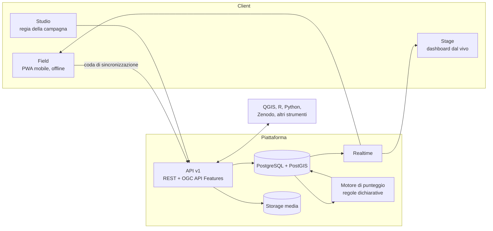
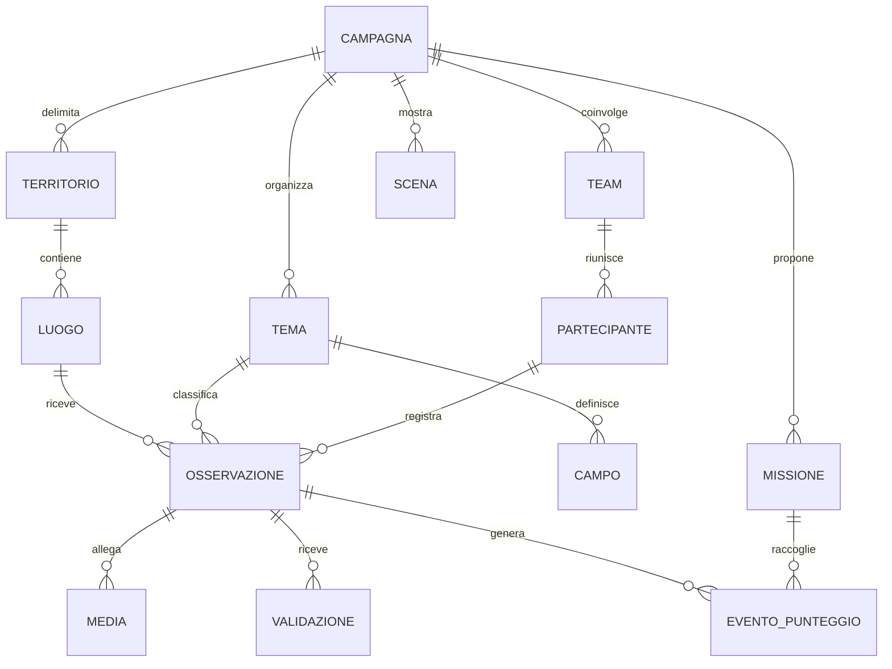

# Territorial Quest — architettura e direzione di stile

Proposta di architettura per trasformare il prototipo descritto nella tesi
(*Learners, Players, Designers*, Design Studies #2) in un software interoperabile
per la ricerca sul campo, la citizen science e il public engagement.

Stato: **proposta da validare**. Nessun codice è stato ancora scritto.

---

## 1. Da dove partiamo: cosa tenere e cosa correggere

Il prototipo era una game board su Figma sincronizzata via plug-in con board Google
Sheets, una per team (12 team, 60 studenti, 3 mesi, oltre 50.000 record).

**Da conservare** (ha funzionato, secondo questionari e risultati):

- un unico luogo per tutti i dati della ricerca;
- la divisione in macro-temi (Ambiente fisico, Flussi di mobilità, Movida, Demografia…);
- le tre famiglie di punteggio **Field / Desk / Feel** e la qualità bassa/media/alta;
- le board configurabili dai team (variabili e parametri propri);
- missioni introdotte a cadenza regolare, il Trend per categoria, "My Best Media".

**Difetti da correggere**, ognuno con la risposta di progetto:

| # | Difetto emerso nella tesi | Risposta nell'architettura |
|---|---|---|
| 1 | La classifica ha generato tensione, meno condivisione tra team, corsa finale ai punti | Nessuna classifica. Un unico punteggio collettivo e missioni condivise (§4) |
| 2 | Premiata la quantità: "cavolate", cartelli, tutti i puntini di Maps | Il valore di un record dipende da novità, validazione e utilizzo, non dal numero (§4.2) |
| 3 | Iniquità tra quartieri con più o meno elementi | Si misura la copertura relativa del proprio territorio, non il conteggio assoluto |
| 4 | Qualità invisibile, chiusa nella board privata | Validazione tra pari visibile a tutti; ogni punto è tracciabile alla regola che lo ha generato |
| 5 | Dati degli altri team non visibili; "è mancata una parte che mettesse insieme il lavoro di tutti" | Dataset comune per campagna; arricchire i dati altrui è un'azione premiata |
| 6 | Dati non riutilizzabili: foto non scaricabili, niente mappa, export Excel impreciso | Dati geografici nativi, export standard, API aperte (§5) |
| 7 | Upload foto solo da memoria locale, problemi di geolocalizzazione | App di rilievo con fotocamera, galleria, URL, GPS e posizionamento manuale su mappa |
| 8 | Difficile gestire più osservazioni dello stesso luogo | Modello dati che separa **Luogo** e **Osservazione** (§3) |
| 9 | Obiettivi poco chiari all'inizio, mancavano esempi, struttura rigida | Onboarding guidato, campagna dimostrativa precaricata, modelli di scheda modificabili |
| 10 | Dal dato grezzo alla visualizzazione è il passaggio più difficile | Stage: visualizzazioni pronte ed export per il Databook (§2.3) |
| 11 | Attività percepita come carico extra e senza fine | Missioni a tempo con chiusura esplicita; la raccolta alimenta direttamente gli elaborati |
| 12 | Catena fragile Figma + Sheets + plug-in, controlli manuali dei tutor | Un solo sistema con database, permessi e regole di punteggio automatiche |

---

## 2. Tre superfici, un solo sistema



### 2.1 Field — il rilievo (mobile)
Per chi è sul territorio. Un'osservazione si registra in meno di 30 secondi: tema,
posizione, foto/audio/nota, percezione. Funziona senza rete e sincronizza dopo.
Mostra la mappa comune, le missioni attive e cosa manca nella zona in cui ci si trova.

### 2.2 Studio — la regia (desktop)
Per docenti, ricercatori, facilitatori. Crea la campagna, disegna il territorio,
definisce temi e schede, imposta missioni e regole di punteggio, segue la validazione,
esporta i dati, gestisce consensi e questionari.

### 2.3 Stage — la scena (schermo grande, pubblico)
Per la restituzione dal vivo. Una **scena** è una vista sui dati (mappa viva, trend per
tema, costellazione delle percezioni, muro dei media, linea del tempo, triade
Field/Desk/Feel). Le scene si compongono in una scaletta, si proiettano in modalità
chiosco e si aggiornano in tempo reale mentre arrivano le osservazioni. Ogni scena ha
un link pubblico, è incorporabile ed esportabile in SVG/PNG per il Databook.

---

## 3. Modello dei dati



- **Campagna**: un'attività (corso, evento di citizen science, laboratorio). Ha licenza
  dei dati, date, regole di punteggio, lingua.
- **Territorio**: poligono dell'area di studio, suddiviso in una griglia esagonale usata
  per misurare la copertura.
- **Tema** e **Campo**: i macro-temi e le variabili di ciascuna scheda. I team possono
  proporre campi nuovi, come nelle board del prototipo.
- **Luogo**: l'entità sul territorio (un parco, un murale, una fermata).
- **Osservazione**: un rilievo su un luogo, di tipo `field`, `desk` o `feel`, con autore,
  data, valori, fonte (per il desk) e stato di validazione. Più osservazioni nel tempo e
  da team diversi convivono sullo stesso luogo.
- **Validazione**: conferma, correzione o arricchimento fatto da un altro partecipante.
- **Evento di punteggio**: registro immutabile di ogni variazione, con la regola che l'ha
  prodotta. Il punteggio è sempre ricalcolabile e spiegabile.
- **Scena**: specifica dichiarativa (JSON) di una visualizzazione.

---

## 4. Gamification cooperativa

Principio: **il gioco si vince insieme, contro l'ignoto del territorio, non contro gli
altri team.** Lo score system del prototipo resta, ma cambia soggetto.

### 4.1 Cosa si vede
- **Un solo punteggio collettivo** per campagna, rappresentato dalla mappa che si
  rivela: il territorio parte in scala di grigi e prende colore dove la conoscenza cresce.
- **Quattro indicatori comuni**: Copertura (celle × temi esplorati), Equilibrio
  (Field/Desk/Feel), Affidabilità (quota validata), Connessioni (scambi tra team).
- Ogni team vede **il proprio contributo al bene comune**, mai una posizione in graduatoria.

### 4.2 Come si calcola il valore di un'osservazione
`valore = base(tipo) × novità × qualità × utilizzo`

- **novità**: decresce se nella stessa cella e nello stesso tema esistono già osservazioni
  simili. Riempire la mappa di puntini non rende nulla.
- **qualità**: vale zero finché l'osservazione non è validata da un membro di un altro
  team o da un tutor; poi bassa/media/alta come nel prototipo.
- **utilizzo**: cresce quando il dato è usato in una scena o in un elaborato.

Le regole sono configurabili per campagna e pubblicate ai partecipanti.

### 4.3 Dinamiche
- **Missioni collettive a tempo** (due settimane, come le sfide dei tutor): soglie comuni
  che sbloccano qualcosa per tutti, ad esempio una nuova scena o un nuovo livello di mappa.
  Alla scadenza la missione si chiude: nessuna corsa dell'ultimo giorno.
- **Azioni tra team premiate per entrambi**: validare, arricchire, collegare, rispondere
  a una richiesta di aiuto su una zona scoperta.
- **Ruoli complementari** derivati dagli archetipi della tesi: esploratore, verificatore,
  cartografo, narratore.
- **Riconoscimenti non rivali**: badge collettivi e traguardi di campagna; "Our Best
  Media" al posto di "My Best Media".

---

## 5. Interoperabilità

| Ambito | Scelta |
|---|---|
| Dati geografici | PostGIS; export **GeoJSON**, **GeoPackage**, **CSV** con coordinate |
| Accesso diretto da GIS | **OGC API – Features** in lettura (QGIS e ArcGIS si collegano senza export) |
| API | REST documentata con **OpenAPI**, chiavi per campagna, webhook sugli eventi |
| Semantica | Luogo/Osservazione allineati a OGC Observations & Measurements; metadati di progetto **PPSR-Core** (citizen science) |
| Pacchetto dati | Archivio con dati, media, dizionario dei campi e metadati **DCAT / Frictionless**, pronto per Zenodo e DOI |
| Import | CSV e Google Sheets (dati storici del prototipo), GeoJSON; XLSForm (ODK/Kobo) in una fase successiva |
| Media | File originali scaricabili, EXIF conservato, licenza per elemento |
| Visualizzazioni | Scene come specifica JSON esportabile; export SVG/PNG |
| Ricerca | Questionari integrati (TAM, SUS, GEQ come nella tesi) e log di attività pseudonimizzati |
| Privacy | Consenso esplicito, pseudonimi, ruoli e permessi a livello di riga, dati in UE |

---

## 6. Stack tecnologico proposto

| Livello | Tecnologia | Motivo |
|---|---|---|
| Applicazione | **Next.js** (App Router, TypeScript), PWA | Un solo codice per Field, Studio e Stage |
| Dati | **Supabase**: PostgreSQL + PostGIS, Auth, Storage, Realtime, RLS | Geografia nativa, tempo reale e permessi senza server da scrivere; ospitabile anche in proprio |
| Offline | IndexedDB (Dexie) + coda di sincronizzazione | Il rilievo non può dipendere dalla rete |
| Mappe | **MapLibre GL** + deck.gl | Open source, senza chiavi proprietarie, 3D |
| Grafici | D3 / Observable Plot | Controllo completo per le scene dello Stage |
| Movimento | GSAP + Lenis; scena 3D con Three.js dove serve | Per l'esperienza immersiva dei riferimenti |
| Dominio | Modulo TypeScript puro per punteggio, validazione schede, esportatori | Testabile e indipendente dall'interfaccia |

Struttura del repository:

```
src/app/(field)    rilievo mobile
src/app/(studio)   regia
src/app/(stage)    dashboard dal vivo
src/app/api/v1     API REST e OGC
src/domain         punteggio, schede, export (TypeScript puro, con test)
src/ui             design system
supabase/          migrazioni, policy, seed della campagna dimostrativa
docs/              questo documento
```

---

## 7. Direzione di stile

Riferimenti analizzati: `why.zero.university`, `learnwithzero.com`,
`app.zero.university/onboard`. Se ne riprende il linguaggio, non il marchio.

**Cosa caratterizza i riferimenti**

- *why.zero*: una scena WebGL a tutto schermo (paesaggio luminoso, particelle) con
  un'interfaccia ridotta a un HUD: righello di avanzamento in alto, pillola XP in alto a
  destra, dock flottante in basso con un'azione primaria scura e pulsanti tondi.
  Micro-etichette monospazio maiuscole. Interazioni gestuali (disegna, tieni premuto).
- *learnwithzero*: sezioni che alternano carta chiara e nero profondo, titoli grandi in
  sans peso 400 con spaziatura stretta, un solo accento verde, pillole e card con raggio
  ampio, città isometrica in scala di grigi come hero, dock persistente in basso.
- *onboard*: schermo nero, una domanda per volta in serif grande, un solo pulsante.

**Traduzione per Territorial Quest**

- **Il territorio è la scena.** Al posto del paesaggio illustrato c'è la mappa 3D
  dell'area di studio, in scala di grigi, che prende colore con i dati raccolti. Stile e
  meccanica cooperativa coincidono: la bellezza della scena è il punteggio collettivo.
- **HUD, non pagine.** Righello di copertura in alto, pillola del punteggio collettivo,
  dock in basso con l'azione primaria ("Nuova osservazione" in Field, "Avvia scena" in
  Stage).
- **Una cosa per volta.** Onboarding e inserimento a schermate singole.

**Token di partenza** (da rifinire insieme nella fase di personalizzazione)

| Ruolo | Valore |
|---|---|
| Inchiostro | `#0B0B0C` |
| Carta | `#F4F3EE` |
| Grigi | `#3D4046`, `#9A9EA7`, `#D4D3CE` |
| Accento | verde, da `#1C4839` (profondo) a un verde vivo per gli stati attivi |
| Dati | tre tinte distinte per Field, Desk, Feel, da validare per contrasto e daltonismo |
| Titoli | sans grottesca peso 400, spaziatura −0,04em (Google Sans Flex, licenza aperta) |
| Momenti narrativi | serif da display (es. Instrument Serif) |
| Etichette e numeri | monospazio maiuscolo spaziato (es. Geist Mono) |
| Forme | pulsanti a pillola, card con raggio 14–32 px, ombre morbide |

I caratteri dei riferimenti (Zero Sans, PP Supply Mono, STK Bureau Serif) sono
proprietari: si usano equivalenti con licenza aperta.

---

## 8. Fasi

1. **Fondamenta** — repository, schema dati, autenticazione, design system e token.
2. **Field** — rilievo offline, mappa comune, luoghi e osservazioni, media.
3. **Cooperazione** — motore di punteggio, validazione tra pari, missioni collettive.
4. **Stage** — scene, scaletta, modalità dal vivo, export per il Databook.
5. **Interoperabilità** — API pubblica, OGC API Features, pacchetto dati, import.
6. **Strumenti di ricerca** — questionari, log pseudonimizzati, report di campagna.

---

## 9. Decisioni aperte

1. **Stack**: confermare Next.js + Supabase.
2. **Hosting**: cloud gestito (Vercel + Supabase, regione UE) oppure infrastruttura di
   ateneo. L'architettura regge entrambe; cambia la fase 1.
3. **Accesso dei partecipanti**: account con email, oppure ingresso con codice campagna
   e pseudonimo (più adatto a eventi pubblici e minori).
4. **Lingue**: solo italiano o italiano + inglese dall'inizio.
5. **Punteggio**: confermare la formula di §4.2 e i quattro indicatori collettivi.
